# projet - KAFKA

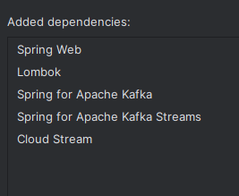

## 2. Avec Docker
### - Créer le fichier docker-compose.yml
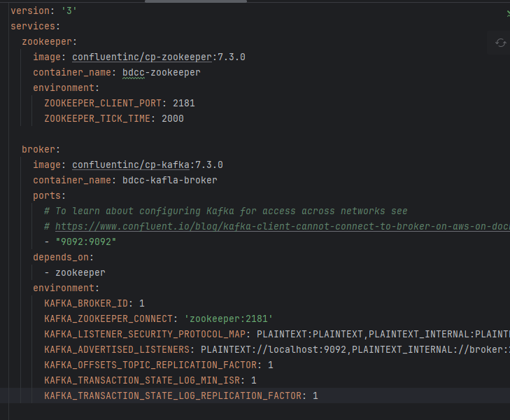
### - Démarrer les conteneurs docker : zookeeper et kafka-broker
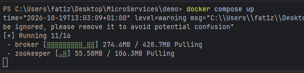
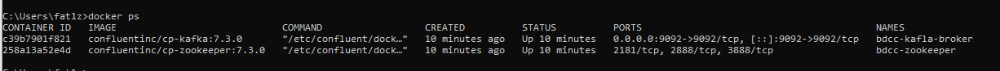
### - Tester avec Kafka-console-producer et kafka-console-consumer
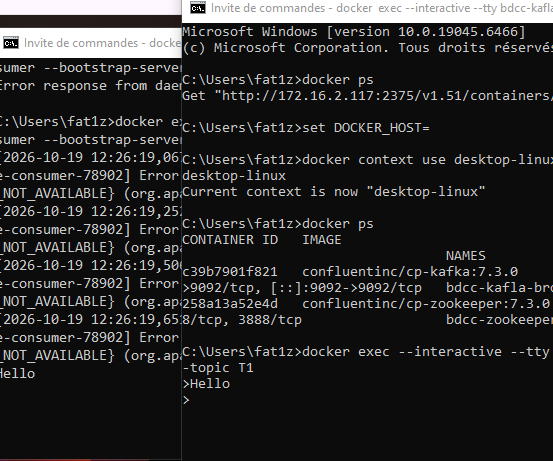

## 3. En Utilisant KAFKA et Stpring Cloud Streams, Créer :
### - Un Service Producer KAFKA via un Rest Controler
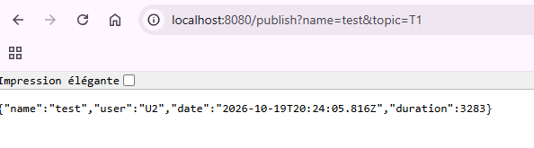
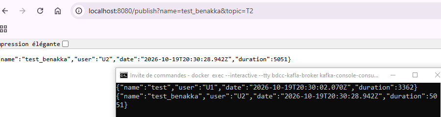
### - Un Service Consumer KAFKA
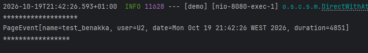
### - Un Service Supplier KAFKA
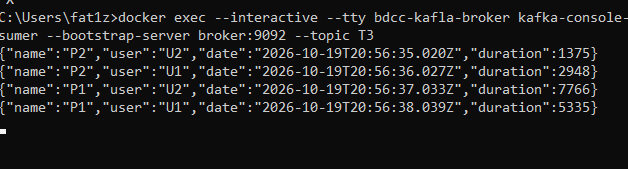
### - Un Service de Data Analytics Real Time Stream Processing avec Kaflka Streams
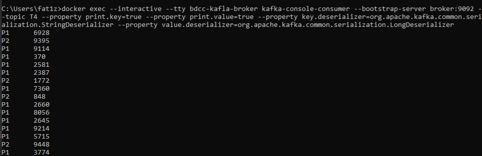
#### avec count
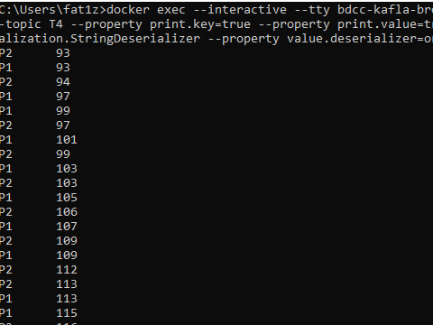
### - Une application Web qui permet d'afficher les résultats du Stream Data Analytics en temps réel
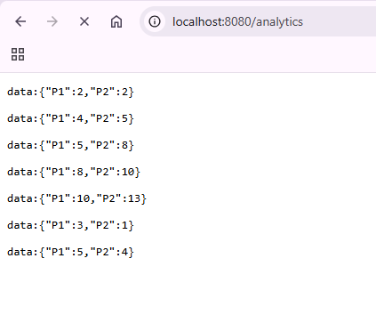
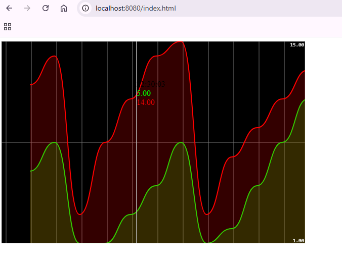
